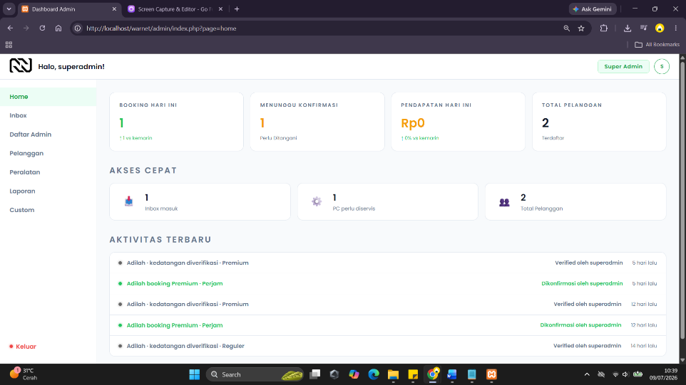
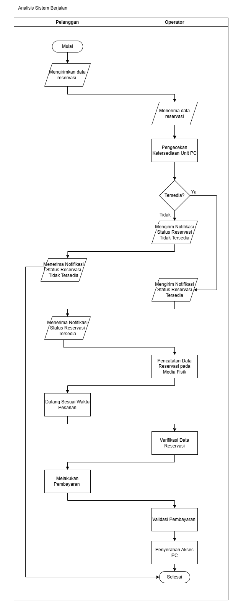
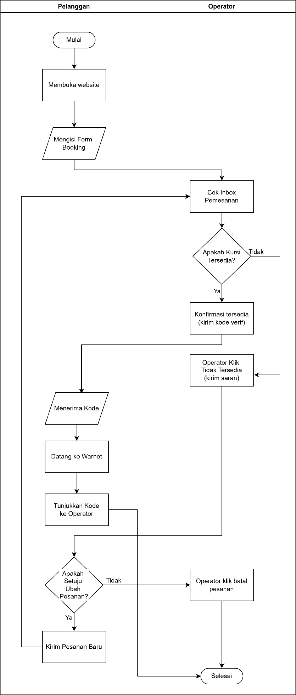
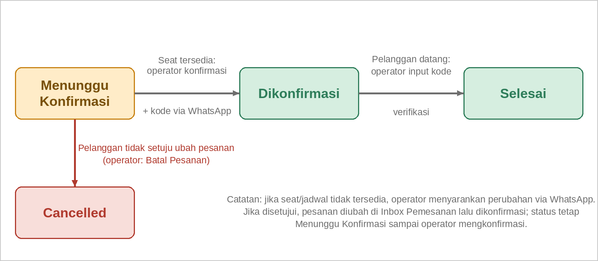
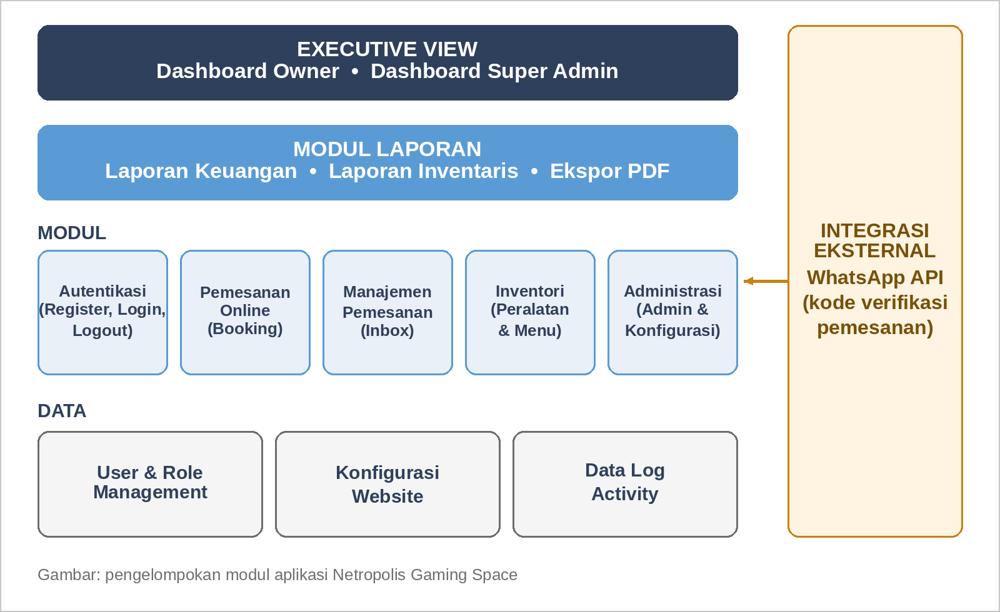
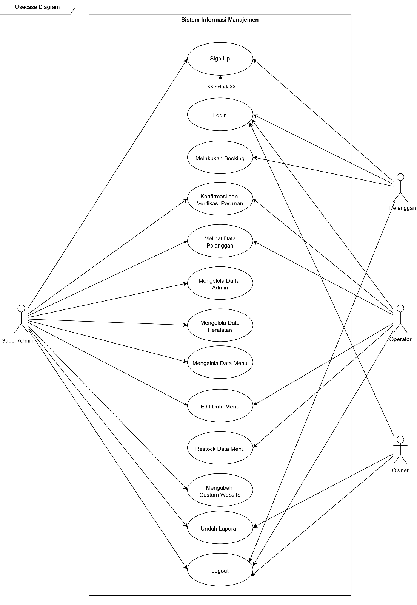
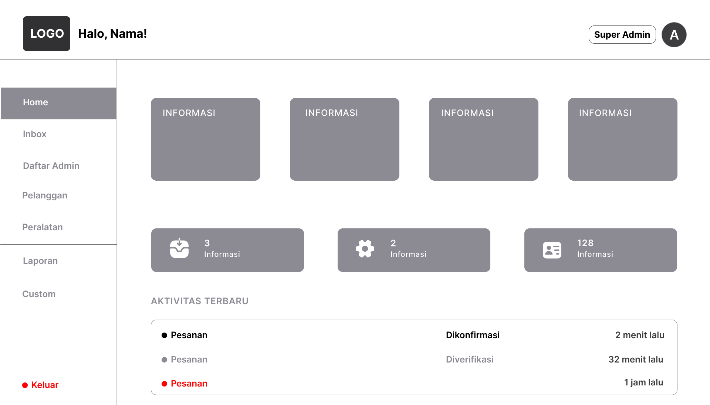
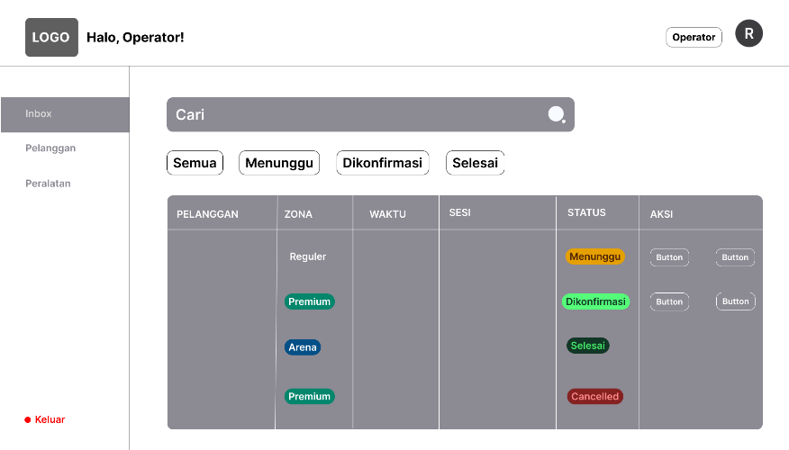

# Netropolis Gaming Space: System Analysis Documentation

Dokumentasi analisis sistem (BRD, FSD, dan UAT) untuk **Website Manajemen Sistem Informasi Netropolis Gaming Space**, sebuah sistem pemesanan PC online, inventori, dan laporan keuangan untuk unit usaha gaming space di Tangerang.

Repositori ini adalah portofolio saya sebagai **IT System Analyst**. Isinya menunjukkan alur kerja analisis dari kebutuhan bisnis sampai pengujian penerimaan pengguna.

> **Konteks:** sistem dikembangkan sebagai proyek skripsi (Universitas Pamulang, 2026) dengan metode Agile Scrum. Saya berperan sebagai analis sekaligus developer. Dokumen BRD, FSD, dan UAT disusun mengikuti struktur dokumen standar industri berdasarkan hasil analisis dan perancangan pada skripsi tersebut.

---

## Ringkasan Proyek

**Masalah:** Reservasi PC dilakukan manual lewat komunikasi dengan operator, dicatat di papan tulis, dan transaksi dicatat di Excel. Akibatnya terjadi antrean, risiko kesalahan hitung, duplikasi data dan bentrokan jadwal, laporan yang lama disusun, serta tidak adanya pencatatan peralatan.

**Solusi:** Website terpusat dengan empat peran pengguna (Pelanggan, Operator, Super Admin, Owner) yang mencakup:
- Pemesanan online dalam tiga langkah (paket bundel atau per jam, pilih zona dan nomor PC, harga terhitung otomatis)
- Pengelolaan pemesanan oleh operator (konfirmasi, ubah, batal, verifikasi kedatangan) dengan kode verifikasi yang dikirim via WhatsApp API
- Inventori peralatan serta stok makanan dan minuman
- Laporan keuangan dengan filter periode dan ekspor PDF
- Konfigurasi harga, zona, dan jumlah PC tanpa mengubah kode program

**Tech stack:** PHP, HTML, CSS, MySQL, Apache (XAMPP), WhatsApp API.



---

## Dokumen

Dokumen disusun berurutan. Setiap dokumen mengacu ke dokumen sebelumnya.

| # | Dokumen | Isi | Format |
|---|---------|-----|--------|
| 1 | **Business Requirement Document (BRD)** | Latar belakang, tujuan, ruang lingkup, pemangku kepentingan, alur proses bisnis (as-is dan to-be), kebutuhan bisnis (BR1–BR6), kebutuhan integrasi (IR1–IR2) | [PDF](docs/01_BRD_Netropolis_Gaming_Space.pdf) · [DOCX](docs/01_BRD_Netropolis_Gaming_Space.docx) |
| 2 | **Functional Specification Document (FSD)** | Arsitektur dan konfigurasi modul, 15 kebutuhan fungsional, 9 kebutuhan non-fungsional, 22 use case beserta skenario dan activity diagram, desain UI, keamanan sistem, struktur basis data | [PDF](docs/02_FSD_Netropolis_Gaming_Space.pdf) · [DOCX](docs/02_FSD_Netropolis_Gaming_Space.docx) |
| 3 | **User Acceptance Testing (UAT)** | Strategi dan prosedur UAT, kriteria penerimaan, 65 skenario uji, log defect, lembar persetujuan, matriks keterlusuran | [PDF](docs/03_UAT_Netropolis_Gaming_Space.pdf) · [DOCX](docs/03_UAT_Netropolis_Gaming_Space.docx) |

```
Kebutuhan bisnis (BRD)  ──►  Spesifikasi fungsional (FSD)  ──►  Pengujian penerimaan (UAT)
      BR1 – BR6                FR-001 – FR-015, UC-01 – UC-22        UAT-001 – UAT-065
```

---

## Cuplikan Hasil Analisis

### Alur proses bisnis

Sistem berjalan (as-is) bergantung pada operator di setiap tahap. Alur yang diusulkan (to-be) memindahkan pemesanan dan pencatatan ke sistem.

| As-is | To-be |
|:-----:|:-----:|
|  |  |

### Alur status pemesanan



### Konfigurasi modul



### Use case diagram

Empat aktor, 22 use case yang dikelompokkan dalam enam modul.



### Rancangan antarmuka (Figma)

| Super Admin: Home | Operator: Inbox Pemesanan |
|:-----------------:|:-------------------------:|
|  |  |

---

## Angka Penting

| Aspek | Jumlah |
|-------|:------:|
| Peran pengguna | 4 |
| Kebutuhan bisnis (BRD) | 6 |
| Kebutuhan fungsional (FSD) | 15 |
| Kebutuhan non-fungsional (FSD) | 9 |
| Use case dengan skenario dan activity diagram | 22 |
| Tabel basis data | 8 |
| Skenario UAT | 65 |
| Sprint (Agile Scrum) | 3 × 8 minggu |

---

## Metode dan Pendekatan

- **Pengumpulan kebutuhan:** observasi langsung, wawancara, dan kuesioner di lokasi usaha.
- **Pengembangan:** Agile Scrum dengan product backlog berprioritas, tiga sprint, serta sprint review dan retrospective di setiap akhir sprint.
- **Pemodelan:** use case diagram, activity diagram, sequence diagram, dan rancangan basis data.
- **Keterlusuran (traceability):** setiap kebutuhan bisnis dipetakan ke kebutuhan fungsional, use case, dan skenario UAT (lihat Lampiran A pada dokumen UAT).
- **Pengujian:** Black Box Testing oleh developer, dilanjutkan UAT yang dirancang untuk dijalankan oleh perwakilan pengguna.

---

## Catatan

- **Hasil UAT belum diisi.** Kolom Hasil Aktual dan Status pada dokumen UAT sengaja dikosongkan karena UAT dijalankan oleh pengguna. Dokumen ini berisi rancangan dan skenario pengujiannya.
- **Nama pemangku kepentingan** pada BRD ditulis berdasarkan peran, bukan nama individu.
- **Akun dan kredensial uji** pada dokumen UAT hanya berupa placeholder.
- Repositori ini berisi dokumentasi analisis. Source code tidak disertakan.

---

## Penulis

**Khusnul Fikroh Adillah**
Program Studi Sistem Informasi, Universitas Pamulang

- LinkedIn: _[AdilahKf](https://www.linkedin.com/in/adilahkf/)_
- Email: _khusnulfikroh@gmail.com_

---

## Lisensi dan Penggunaan

Dokumen pada repositori ini dibuat untuk keperluan portofolio dan pembelajaran. Mohon cantumkan sumber apabila mengutip atau menggunakan kembali struktur dokumennya.
